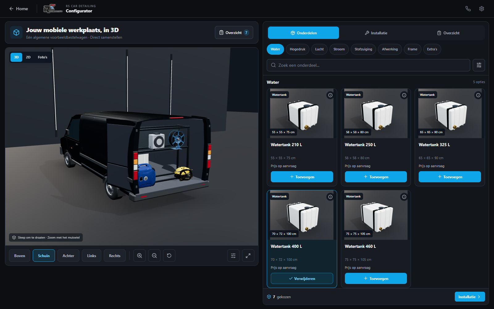
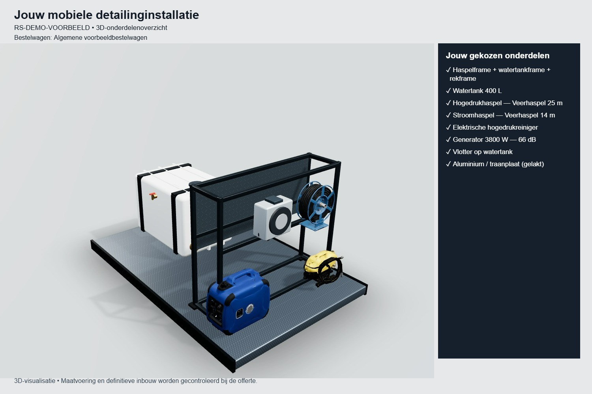

# Onderdeelstudio en configuratieafbeelding — 27 oktober 2026

Deze iteratie gebruikt de bestaande React/Three.js-configurator en de al gemaakte Thrixel-assets. De homepage en live deployment zijn ongemoeid gelaten.

## Wat werkt

- Merkloze donkere bestelwagen: lak met clearcoat, studioverlichting zonder externe HDRI, geopende/deels wegklapbare carrosserie, achterdeuren, camera's, draaien en zoomen.
- 44 kleine JPG-onderdeelrenders, gemaakt van dezelfde modellen en catalogusafmetingen als de installatie. Geen hergebruikte foto van een niet bijbehorend onderdeel en geen extra canvas per kaart. Alle renders samen circa 685 KiB.
- Tank met riemen/aansluitingen, metalen frame met bovenplaat en optionele opslag, afzonderlijke stroomhaspel, compressor met vinnen/manometers, stofzuiger met wielen/slang en accessoireset. De bestaande Thrixel GLB's voor hogedrukhaspel, generator en elektrische reiniger blijven behouden.
- Toevoegen/verwijderen blijft verbonden met de bestaande layout- en compatibiliteitscontrole.
- Een afzonderlijke 3D-onderdelenopstelling zonder bus wordt opnieuw gerenderd uit precies de gekozen configuratie. De klant ziet een kleine voorvertoning en krijgt bij het voorbereiden van de aanvraag een downloadbare JPG met onderdelenlijst, referentie en opgegeven bestelwagen. De volledige JSON-aanvraag bevat dezelfde JPG en wacht op beoordeling.
- Capture wacht op geladen GLB's. Ontbrekende fysieke plaatsingen leveren geen misleidende incomplete afbeelding op. Renderverzoeken verlopen na elkaar; tijdelijke GPU-contexten worden vrijgegeven. De cache is gekoppeld aan de complete configuratie.
- Bij ontbrekende WebGL verschijnt een expliciete melding; de tekstsamenvatting blijft beschikbaar.

## Build World en Thrixel

Build World is eerder geïnstalleerd op `~/.codex/skills/build-world`; de lokale skill is bijgewerkt/gecontroleerd. De officiële `thrixel-mcp@latest` CLI en de bestaande accountverbinding werken. De MCP-configuratie is aanwezig, maar rechtstreekse Thrixel MCP-tools zijn in deze chatsessie niet blootgesteld; eerder is daarom de officiële CLI gebruikt.

Deze iteratie doet **geen nieuwe generatieaanroepen**: 0 extra Thrixel-credits, laatst gecontroleerd saldo 137. Er zijn geen nieuwe GLB's gegenereerd. De genoemde nieuwe modellen zijn procedureel opgebouwde visualisaties; geen fabrikant-CAD of exacte productscans. Kaarten zijn afgeleide renders van onze bestaande/eigen visualisaties. Geen WEATHER GUARD-assets overgenomen.

## Validatie

- `npm test`: pricing-, configurator-, fit-, gewicht-, compatibiliteits- en nieuwe opstellings-/selectiesamenvattingtests geslaagd.
- `npx tsc --noEmit`: geslaagd.
- `npm run build`: geslaagd. Bestaande CSS `@import`-volgordewaarschuwing blijft; Three.js-chunk groter dan 500 kB. De 3D-code is apart en wordt uitgesteld geladen (circa 279 kB gzip; hoofdcode circa 82 kB gzip).
- `node scripts/browser-qa.mjs`: desktop en mobiel zonder WebGL geslaagd, inclusief configuratie en aanvraag.
- `node scripts/studio-3d-qa.mjs`: echte WebGL op Intel Iris Xe in Edge, 1600×1000 en touch-emulatie 390×844. Camera, zoom, touch-draaien, generator verwijderen, bijbehorende aanvraagafbeelding, JSON en opruimen van tijdelijke roots geslaagd. Geen browser-runtimefouten.
- `node scripts/profile.mjs`: drie runs van 120 frames per schermformaat, warme shaders en continu draaien. Mediaan 16,5–16,7 ms; p95 18,3–20,7 ms. Circa 294k driehoeken, 180–194 draw calls; 0 frames boven 50 ms in deze runs. Eerste gereedmelding circa 14 s desktop en 5,8 s mobiele emulatie in de ontwikkelserver. **Geen meting op een fysieke telefoon** en geen prestatiegarantie voor zwakkere apparaten.
- Visuele controle: desktop, mobiele layout, onderdeelkaarten en JPG-uitvoer bekeken. De visuele criticus bevestigde de samenhang maar wees terecht op onvoldoende fotorealisme van de busgeometrie.

Bewijs: [browserresultaten](studio-review/browser-results.json), [prestaties](studio-review/performance.json). GitHub Actions controleert build, TypeScript, tests en de UX zonder WebGL; hardwaretesten zijn lokaal uitgevoerd.

## Grenzen en volgende stap

De bus is nog een **gestileerd generiek voertuig**, geen getrouwe of fotorealistische Ford Transit Custom. Betere lak en licht lossen de huidige geometrie niet volledig op. De cargo-envelope is indicatief; officiële maatvoering, bevestigingen, veilige opstelling, productdrooggewichten en werkelijk laadvermogen blijven installateurswerk. Ook productmodellen zijn visuele benaderingen, geen exacte exemplaren van elk merk/SKU.

E-mailverzending en ontvangst door de beheerder zijn **niet actief**. De knop zegt daarom “Aanvraag voorbereiden”, niet dat iets gemaild is. De afbeelding zit wel in de downloadbare aanvraag; lokale opslag laat grote afbeeldingen bewust weg om quota niet te overschrijden. Er is geen definitieve offerte verzonden.

De grootste volgende kwaliteitsstap is een geschikt realistisch voertuigmodel met controleerbare gebruiksrechten en correcte scharnieren/laadruimte, plus productmodellen op basis van goedgekeurde maatvoering. Daarna kan de aparte, al onderzochte offertebackend met ingestelde servergeheimen, testontvangers en beheerdergoedkeuring worden gekoppeld en getest. Deze PR merge- of publiceert niets.

Kaarten opnieuw maken: start Vite en draai `node scripts/bake-product-renders.mjs`. Optioneel `PRODUCT_IDS` als kommagescheiden selectie. Dit gebruikt lokaal Three.js en verbruikt geen Thrixel-credits.
