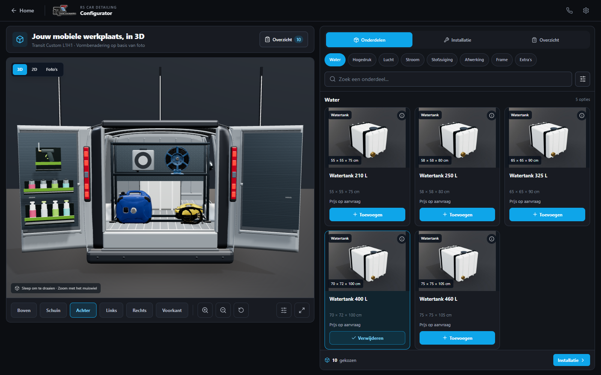
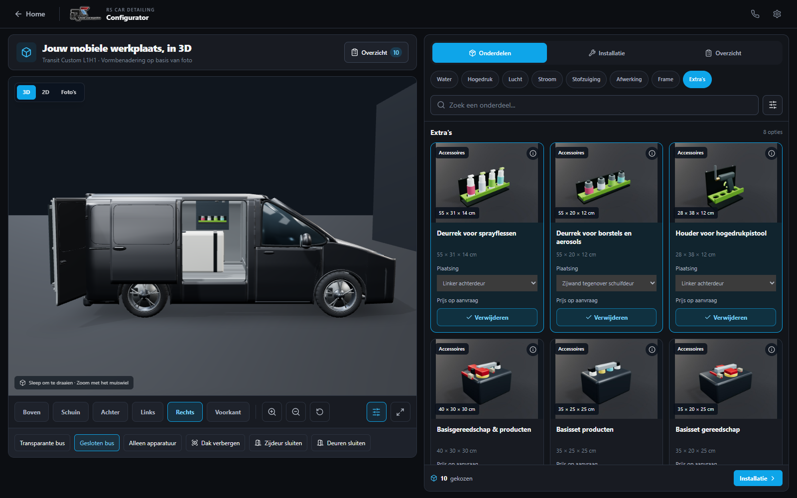
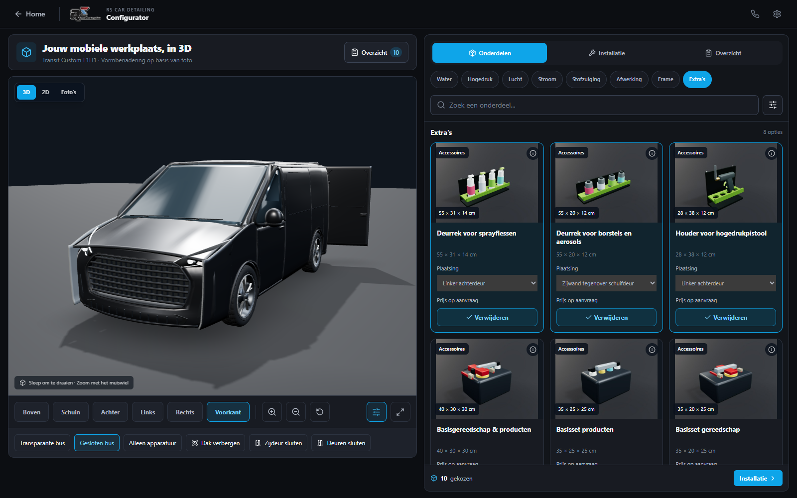
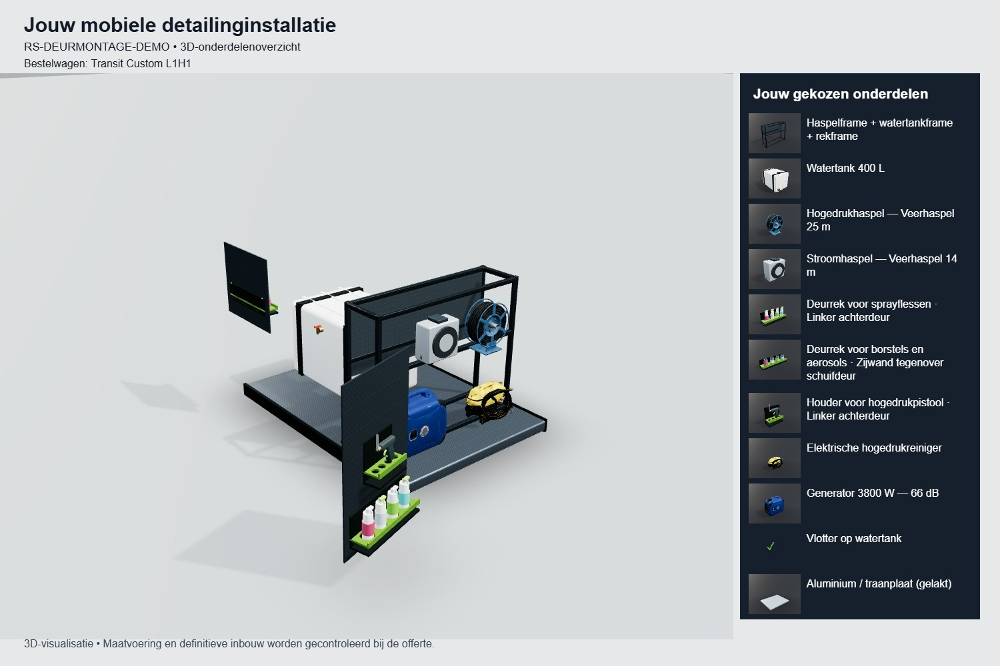

# Transit Custom-vorm en deurinrichting — 27 oktober 2026

De vorige gestileerde bus is vervangen door een nieuwe, originele Thrixel-vormbenadering, gemaakt met de door de klant meegestuurde Transit Custom-foto als referentie. Lagere daklijn, schuine voorruit, korte neus, smalle koplampen, grote grille, lichtmetalen wielen en een afzonderlijke zijschuifdeur zijn nu onderdeel van het model. Geen Ford-logo, fabrikant-CAD of WEATHER GUARD-assets gebruikt. Het resultaat is nadrukkelijk geen exact of fotorealistisch Ford-model.

## De inrichting uit de realisatiefoto's

- Drie nieuwe, dimensionele visualisaties: flessenrek, borstel/aerosolrek en pistoolhouder. De eigen JPG-kaarten komen uit dezelfde meshes.
- Per geschikt onderdeel is een linker achterdeur, rechter achterdeur of vaste zijwand tegenover de schuifdeur te kiezen. De camera draait automatisch naar de gekozen toegang.
- Achterdeurrekken zijn via dezelfde scharniertransformatie aan het deurblad gekoppeld. De traanplaatpanelen bewegen ook mee.
- De zijdeur schuift echt open en dicht. Het zijwandrek blijft vast staan: een diep rek aan het schuivende blad zou de carrosserie kunnen raken. Dit is een bewuste fysieke beperking, geen ontbrekende animatie.
- Meerdere rekken stapelen per deur. Er zijn controles op rekbreedte, beschikbare hoogte en botsingen in gesloten toestand. Er wordt nooit stilzwijgend een te groot deurrek op de vloer gezet.
- Frame en onderste apparatuur zijn iets naar binnen geplaatst voor sluitruimte. De vloerzoeker benut ook banen tussen de wielkasten.
- Montagekeuzes blijven in de aanvraag en de snapshot behouden. De export toont dezelfde gekozen meshes met montagecontext en een onderdelenlegenda met miniaturen, zodat ook een deels verborgen onderdeel herkenbaar is.

## Afmetingen en modelgrenzen

De laadruimtelengte van 2602 mm en maximumbreedte van 1777 mm zijn getoetst aan de [Ford Transit Custom-prijslijst, pagina 25](https://www.ford.co.uk/content/dam/guxeu/uk/documents/price-list/commercial-vehicles/PL-New_Transit_Custom.pdf). Dezelfde bron vermeldt onder meer 5050 mm voertuiglengte, 3100 mm wielbasis, 1392 mm tussen de wielkasten en een achterdeurdoorgang van 1400 × 1314 mm. Het model gebruikt een conservatieve visuele laadhoogte van 1405 mm; die is geen gecertificeerde maat voor de klant zijn eigen uitvoering. De werkelijke doorhoogte, bekleding, bevestigingen en apparatuurmaten moeten vóór productie worden gecontroleerd.

De buitenvorm is niet nauwkeurig genoeg voor carrosseriepassing: onder meer de gegenereerde spiegels zijn breder dan Ford opgeeft. Het model wordt daarom niet opgerekt bij een andere voertuigomschrijving. Gewichts- en montagebeoordeling blijven vereist. De onderdelen zijn visuele voorbeelden, geen exacte scans van specifieke merken/SKU's.

## Build World, Thrixel en kosten

Build World en de officiële Thrixel CLI zijn gebruikt. Rechtstreekse Thrixel MCP-tools zijn in deze sessie niet beschikbaar; de bestaande officiële CLI/accountverbinding werkt. Er is één nieuwe Architect Plus-generatie uitgevoerd, met losse bewerkbare onderdelen en de referentiefoto. Job: `167da395-2f24-4b24-b6d7-9a2ec8a0e4e1`.

Deze generatie werd variabel op **80 credits** afgerekend; de aanvankelijke verwachting was circa 35. Het saldo ging van **137 naar 57**. Geen betaalde detail-, sculpt- of textuurpass toegevoegd. Een tijdelijke download/netwerkfout is opgelost door de reeds geïnstalleerde CLI uit de lokale cache te gebruiken. Er is geen tweede generatie gestart.

De 390 bronmeshes zijn lokaal per materiaal samengevoegd tot negen complete assemblages, met behoud van alle bewegende onderdelen. Alleen de onjuiste elliptische schuifdeurrubbermesh is vervangen door een rechthoekig afgerond profiel. Het GLB telt 189.988 driehoeken en is circa 4,4 MB. `scripts/optimize-van.mjs --transit-canonical` normaliseert de laadvloer en houdt de volledige deuronderdelen bijeen; geen extra generatiecredits nodig.

## Controle

- `npm test`: bestaande regressies plus deurcapaciteit, sluitruimte, geroteerde enveloppen, open standen, aanvraag/snapshot en GLB-integriteit geslaagd.
- `npx tsc --noEmit` en productiebuild geslaagd. Bestaande CSS-importvolgorde- en Three.js-bundlegroottewaarschuwingen blijven.
- `scripts/door-studio-qa.mjs`: desktop en mobiel schermformaat met echte WebGL. Gemeten wereldposities bevestigen dat achterdeurrekken meedraaien, de vaste zijwandmontage blijft staan en de schuifdeur afzonderlijk beweegt. Verplaatsen via de echte dropdown, verwijderen en JPG-export slagen.
- Bestaande browserchecks zonder WebGL en de gewone 3D/aanvraag-regressie slagen op desktop en mobiel.
- Lokale performance- en browsermetingen staan in [de testmap](transit-review/). Tests gebruiken Edge met Intel Iris Xe en mobiele touch-emulatie; er is geen fysieke telefoon getest.

De homepage is ongewijzigd. E-mailverzending is nog niet actief; de afbeelding zit in de downloadbare aanvraag. De gebruiker heeft inmiddels uitdrukkelijk doorlopende toestemming gegeven om wijzigingen na geslaagde controles via PR naar main te mergen en live te publiceren.

Volgende kwaliteitsstap: echte productmaten en bevestigingspunten per klantuitvoering controleren; voor een exacte Ford-carrosserie is een geschikt model met controleerbare gebruiksrechten nodig.

Leveringsoptimalisatie: ongebruikte UV-buffers verwijderd (het model gebruikt geen ingebedde texturen), normals als genormaliseerde 16-bit waarden met correcte uitlijning opgeslagen, en indices verliesvrij naar 16-bit teruggebracht. Posities, afmetingen en alle driehoeken zijn behouden. Daarmee daalt het bestand van 7,4 naar circa 4,4 MB zonder de busvorm te veranderen.
